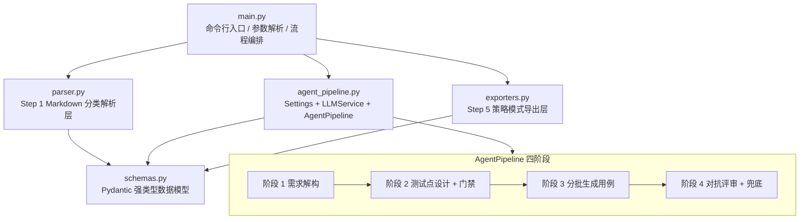
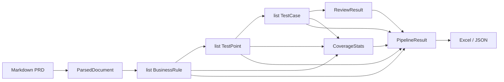
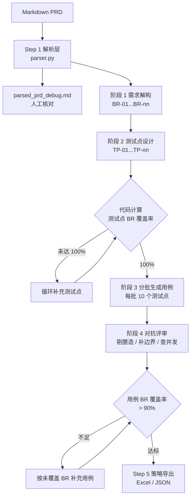

# 高精度测试用例生成智能体

从 Markdown 形式的 PRD（产品需求文档）出发，自动完成 **解析 → 需求解构 → 测试点设计 → 用例生成 → 对抗评审 → 导出** 的全链路，产出可直接执行、可追溯的测试用例 Excel。

设计原则一句话：**凡是可以确定性计算的，一律交给代码；只有需要语义理解的，才交给大模型。**

编号（`BR-xx` / `TP-xx` / `TC-xxx`）、覆盖率计算、门禁判定、兜底补全全部由 Python 完成；模型只负责读懂需求、拆规则、写用例。这样即使模型输出不稳定，最终产物仍然结构规整、覆盖率可验证。

---

## 一、核心内容

### 1. 能解决什么问题

| 痛点 | 本项目的做法 |
|---|---|
| 人工从 PRD 拆测试点耗时且容易漏 | 自动把 PRD 拆成原子级业务规则，再按规则穷举测试点 |
| 模型生成用例爱偷懒、长输出被截断 | 按规则/测试点分批调用，每批独立落盘 |
| 模型自称"已覆盖全部需求"不可信 | 用 Python 集合比对真实计算覆盖率，不达标自动补、补不上就中断 |
| 模型爱编造 PRD 里没有的字段和流程 | 独立对抗评审 + 代码级孤儿用例剔除，双重剔除幻觉 |
| 图表、原型图里的规则读不到 | 图表源码打标签保留；图片按类型走专用 Prompt 调视觉模型 |

### 2. 五步产出

| 步骤 | 产出 | 编号规则 |
|---|---|---|
| Step 1 解析层 | 结构化文档 + `parsed_prd_debug.md` | — |
| Step 2 需求解构 | 原子级业务规则 | `BR-01`、`BR-02`… |
| Step 3 测试点设计 | 测试点 | `TP-01`、`TP-02`… |
| Step 4 用例生成 | 测试用例 | `TC-001`、`TC-002`… |
| Step 5 导出 | Excel / JSON | — |

### 3. 双重覆盖率门禁

| 门禁 | 判定条件 | 不达标时 |
|---|---|---|
| 测试点门禁 | 测试点 BR 覆盖率 **= 100%** | 循环补充测试点（最多 3 轮）→ 仍缺失则代码兜底 → 仍不达标直接抛异常中断 |
| 用例门禁 | 用例 BR 覆盖率 **> 90%** | 按未覆盖 BR 补充用例（最多 2 轮）→ 仍不足则代码兜底用例 |

---

## 二、系统架构

### 1. 分层结构



### 2. 目录结构

```
qa_agent/
├── main.py               # 入口：解析参数 → Step 1 解析 → 四阶段流水线 → Step 5 导出
├── parser.py             # Step 1：Markdown 分类解析（章节 / 图表 / 图片）
├── schemas.py            # 全流程 Pydantic 数据模型 + 枚举归一化
├── agent_pipeline.py     # 配置读取、LLM 调用封装、四阶段编排、覆盖率计算
├── exporters.py          # BaseExporter + ExcelExporter / JsonExporter / XMind 占位
├── requirements.txt      # 依赖清单
├── .env.example          # 环境变量模板
├── sample_prd.md         # 示例 PRD（业务规则 + Mermaid + 图片引用）
├── assets/               # 示例 PRD 引用的图片素材
└── outputs/              # 运行产物，按 <PRD名>_<时间戳>/ 分目录
```

### 3. 模块职责

| 模块 | 关键内容 | 职责 |
|---|---|---|
| `main.py` | `build_parser()`、`main()` | 参数解析、`Settings` 加载、创建运行目录、串联各层、打印结果摘要 |
| `parser.py` | `PRDParser`、`_process_image`、`_guess_image_kind` | 章节切分、图表打标签、图片分类与视觉解析、原位替换 |
| `schemas.py` | `BusinessRule`、`TestPoint`、`TestCase`、`ReviewResult`、`CoverageStats`、`PipelineResult` | 全链路数据结构定义与字段约束 |
| `agent_pipeline.py` | `Settings`、`LLMService`、`AgentPipeline` | 环境配置、模型调用与降级、四阶段实现、编号分配、覆盖率统计 |
| `exporters.py` | `BaseExporter`、`ExcelExporter`、`JsonExporter` | 策略模式导出与 Excel 美化 |

### 4. 核心数据模型

| 模型 | 关键字段 | 说明 |
|---|---|---|
| `ParsedDocument` | `title`、`sections`、`diagrams`、`images`、`parsed_markdown` | 解析结果；`to_context(max_chars)` 生成送入模型的正文 |
| `BusinessRule` | `id`、`category`、`content`、`source` | `category` 为业务规则 / 状态流转 / 字段校验 / 隐含异常 |
| `TestPoint` | `id`、`title`、`description`、`technique`、`rule_ids`、`priority`、`category` | `rule_ids` 是覆盖率计算的核心依据 |
| `TestCase` | `id`、`title`、`test_point_id`、`rule_ids`、`priority`、`case_type`、`preconditions`、`steps` | `TestStep` 由 `action` + `expected` 一一对应组成 |
| `ReviewResult` | `summary`、`coverage_notes`、`removed_or_merged`、`final_cases` | 评审结论与剔除留痕 |
| `CoverageStats` | 规则总数、两项覆盖率、`uncovered_rule_ids`、`gate_passed` | 门禁判定结果 |
| `PipelineResult` | 上述全部 + `model`、`generated_at` | 交给导出层的最终载体 |

---

## 三、实现方式

### 1. Step 1　Markdown 分类解析（`parser.py`）

**章节切分**
按 `#{1,6}` 标题维护标题栈，每遇标题就 flush 当前章节，记录 `index` / `title` / `level` / `path` / `content`。

**代码块处理**
进入三反引号围栏时记录语言；`mermaid` / `plantuml` 块**原样保留源码**，并在块前插入标签：

```
<!-- diagram: 状态图 (mermaid) -->
```

图表类型由 `_guess_diagram_kind()` 依据代码前 3 行判断：`statediagram` → 状态图，`sequencediagram` → 时序图，`flowchart` / `graph` → 流程图，PlantUML 按有无 `state` / `sequence` / `actor` 区分。

**图片分类**
同时支持 Markdown `` 与 HTML `` 两种写法。`_guess_image_kind(alt, ref, section)` 把 **alt 文本 + 图片路径 + 所在章节标题** 拼在一起判断：

- 命中 `流程 / flow / 状态 / state / 时序 / sequence / 架构 / 泳道 / 生命周期` → `FLOW`，走流程图专用 Prompt（提取判断条件、Yes/No 分支、异常回退、起止状态）；
- 命中 `ui / 原型 / 页面 / 设计稿 / 弹窗 / 交互稿` → `UI`，走 UI 原型图专用 Prompt（逐字段提取必填标识、长度/格式限制、默认值、按钮默认状态、报错文案）；
- 都不命中 → `OTHER`，走通用描述 Prompt。

流程词优先于 UI 词，避免「退款状态流转图」被误判为原型图。

**容错设计**
- 本地图片不存在：打 WARNING，用占位描述兜底，`ImageRef.exists=False`，**不中断整篇解析**；
- 单张图视觉解析失败：捕获异常并记录 WARNING，继续处理后续图片；
- 本地 SVG 无法送视觉模型时，用正则抽取 `<text>` 节点文本作为描述。

**原位替换**
图片在原文中被替换为：

```
**[图片解析 · UI原型图]** 登录页包含手机号、密码输入框…（原图：assets/login.png）
```

视觉解析成功标 `图片解析`，否则标 `图片占位`。整篇替换后的 Markdown 写入 `parsed_prd_debug.md` 供人工核对。

### 2. LLM 调用层（`LLMService`）

**结构化输出 + 自动降级**

```
beta.chat.completions.parse(response_format=PydanticModel)
   ├─ 成功 → 直接拿到强类型对象
   └─ 失败（如网关不支持 json_schema）
        → 缓存 _structured_supported = False
        → 后续全部走 chat.completions.create(response_format={"type": "json_object"})
```

缓存这个标记的目的是：只在第一次产生 400，之后不再重复无效请求。

**Schema 注入**
JSON 模式下模型看不到 Pydantic 结构，会把 `content` 写成 `rule` 之类。因此 `_json_completion(system, user, schema)` 会把 `schema.model_json_schema()` 以 JSON 文本注入 system prompt，并显式要求"必须严格使用下面的字段名、嵌套结构与枚举值"。视觉侧的 `ImageExtraction` 同样注入。

**JSON 提取**
`_extract_json()` 负责剥离开头的 json 代码围栏、截取首个完整 JSON 对象，兼容模型多说话的情况。

**枚举归一化（`schemas.py`）**

模型经常把 `状态流转测试` 写成 `状态流转`、把 `P0` 写成 `p0` 或"高"。如果用严格枚举校验，一整批用例都会解析失败。因此对 `Priority` / `CaseType` / `RuleCategory` 使用 `Annotated[Enum, BeforeValidator(归一化函数)]`：

- `状态流转`、`状态机` → `状态流转`（规则分类）或 `状态流转测试`（用例类型）
- `功能`、`正常` → `功能测试`
- `边界值` → `边界测试`；`p0`、`高` → `P0`

### 3. 阶段 1　需求极尽详细解构

**分段策略**
`_split_document(document, max_chars=1800)` 优先按章节、其次按段落切分，保证每段不超过 1800 字符且不切断段落。逐段调用模型，提示"本段最多输出 20 条规则，不要重复其他分段"。

**截断重试**
若单段输出仍被截断导致 JSON 校验失败（`ValidationError`），用压缩提示重试一次：本段最多 12 条、每条不超过 50 个汉字。

**编号与去重**
模型不负责编号。`_dedupe_rules()` 按内容去重后，`_assign_rule_ids()` 统一赋 `BR-01…`。若最终一条规则都没有，直接抛异常，避免空跑。

### 4. 阶段 2　测试点设计与 BR 覆盖率门禁

**分批设计**
规则按每批 12 条送入模型（`_chunked(rules, 12)`），PRD 上下文截断到 12000 字符。提示要求"每条 BR 至少被引用一次，并补充跨规则组合场景"。

**rule_ids 清洗**
`_sanitize_point_rule_ids()` 只保留真实存在的 BR 编号，防止模型编造 `BR-99` 污染覆盖率统计。

**集合比对 + 补充循环**

```python
covered = {rid for point in points for rid in point.rule_ids}
uncovered = [rule for rule in rules if rule.id not in covered]   # _uncovered_rules
```

有未覆盖规则就进入补充循环（`MAX_COVERAGE_ROUNDS = 3`），每轮把未覆盖规则按 12 条分批再送模型，并附带已有测试点标题避免重复。

**确定性兜底**
连续 3 轮仍未覆盖的规则，由 `_fallback_test_point(rule)` 直接生成一条测试点，规则原文进 `description`，保证 100% 覆盖。

**硬门禁**
`run()` 中计算 `_rule_coverage`，覆盖数不等于规则总数就抛 `RuntimeError`，流程不会带着缺口继续跑。

### 5. 阶段 3　用例分批生成

- 测试点按 `batch_size`（默认 10）分批，每批只送相关的 BR 与测试点，控制上下文长度；
- 每批结果立即落盘 `03_cases_batch_XX.json`，中途失败也不丢已生成内容；
- 用例的 `rule_ids` 会二次清洗；若清洗后为空，则继承所属测试点的 `rule_ids`；
- 编号由 `_to_test_cases()` 统一生成 `TC-001…`，同时兼容评审阶段返回的临时编号（先 `pop("id")` 再重建，避免重复关键字）。

### 6. 阶段 4　对抗评审与双重兜底

**对立视角评审**
用例按每批 12 条送评审模型，同批附带 PRD 上下文、全部规则、相关测试点。`REVIEW_SYSTEM` 明确要求：

- 引用 PRD 中不存在的字段 / 状态 / 接口 / 页面的用例**必须从 `final_cases` 删除**，并记入 `removed_or_merged`；
- 合并高度重复用例；
- 逐条核对**异常、边界值、空数据（空/null/未填）、并发幂等**是否充足。

**代码级幻觉剔除**
`_drop_structurally_invalid_cases()` 在模型评审之后再兜一层：`rule_ids` 全部无法映射到真实 BR 的孤儿用例直接删除，避免模型"嘴上说删了、实际没删"。

**覆盖率补充与兜底**
计算用例级覆盖率，未超过 90% 时按未覆盖规则分批补充（`MAX_CASE_SUPPLEMENT_ROUNDS = 2`）；仍不足则 `_fallback_case()` 生成兜底用例，`remarks` 标注"建议人工细化步骤与数据"。

**场景充足性审计**
`_audit_scenario_sufficiency()` 用代码统计：

- 异常测试、边界测试条数（按 `case_type`）；
- 空数据场景（关键词匹配：`空 / 为空 / null / 未填 / 不填 / 缺省 / 空白`）；
- 并发/幂等场景（关键词：`并发 / 幂等 / 重复提交 / 竞态 / 同时`）；
- 按规则类别反查缺失：字段校验类无边界用例、隐含异常类无异常用例、状态流转类无状态用例，列出对应 BR 编号。

结论追加进 `coverage_notes`，随 `04_review.json` 和 Excel 覆盖率 Sheet 一起交付。

### 7. Step 5　策略模式导出（`exporters.py`）

**抽象与注册**

```python
class BaseExporter(ABC):
    format_name: str
    extension: str
    @abstractmethod
    def export(self, result: PipelineResult, output_path: Path) -> Path: ...
```

`get_exporter(fmt)` 返回对应实现。新增格式只需实现 `export()` 并注册一行，流水线无需改动。

**ExcelExporter**

- Sheet「测试用例」10 列：用例编号 / 标题 / 关联测试点 / 覆盖规则 / 优先级 / 用例类型 / 前置条件 / 操作步骤 / 预期结果 / 备注；
  - 表头深蓝底白字加粗，`freeze_panes="A2"` 冻结首行；
  - 全表 `wrap_text=True` 自动换行 + 细边框，列宽按内容预设；
  - 步骤与预期按 `1. 2. 3.` 换行编号，保证一一对应；
  - 优先级标色：P0 红 `FFC7CE`、P1 黄 `FFEB9C`、P2 蓝 `DDEBF7`、P3 绿 `E2EFDA`；
  - `auto_filter` 全表筛选。
- Sheet「覆盖率统计」分两块：
  - 上半汇总：规则总数、测试点覆盖数/覆盖率、用例覆盖数/覆盖率、门禁结论、测试点与用例总量、未覆盖规则、评审结论、生成模型、生成时间；
  - 下半逐条 BR 明细：`BR 编号 / 规则分类 / 规则描述 / 关联用例数 / 覆盖状态`，关联用例数用 `Counter` 统计，未覆盖行标红、已覆盖标绿，并冻结明细表头 + 筛选。

**JsonExporter** 输出 `PipelineResult.model_dump(mode="json")`，含全部中间结果。**XMindExporter** 仅保留接口，调用时抛 `NotImplementedError`。

---

## 四、数据流转



---

## 五、快速开始

### 1. 安装

```powershell
python -m venv .venv
.\.venv\Scripts\python.exe -m pip install -r requirements.txt
```

### 2. 配置 `.env`

复制 `.env.example` 为 `.env`：

| 变量 | 必填 | 说明 |
|---|---|---|
| `LLM_API_KEY` | 是 | OpenAI 兼容接口的 API Key |
| `LLM_BASE_URL` | 否 | 兼容网关地址，留空用官方地址 |
| `TEXT_MODEL` | 是 | 文本模型，用于解构、设计、生成、评审 |
| `VISION_MODEL` | 视情况 | 视觉模型，用于图表/原型图细节提取 |
| `LLM_TEMPERATURE` | 否 | 默认 0.2 |
| `LLM_MAX_TOKENS` | 否 | 默认 8192 |
| `OUTPUT_DIR` | 否 | 默认 `outputs` |

### 3. 运行

```powershell
# 只跑解析层：不调用大模型、零费用，用于核对图表标签与图片替换
.\.venv\Scripts\python.exe main.py sample_prd.md --dry-run --no-vision

# 完整四阶段流程，导出 Excel
.\.venv\Scripts\python.exe main.py sample_prd.md --no-vision -f excel

# 生成自己的 PRD 用例
.\.venv\Scripts\python.exe main.py "D:\docs\我的需求.md" -f excel
```

> `--no-vision` 用于跳过图片视觉解析（文本模型不支持多模态时使用）。配置了多模态 `VISION_MODEL` 后去掉该参数，图片细节会参与后续分析。

### 4. CLI 参数

| 参数 | 说明 |
|---|---|
| `prd` | PRD Markdown 路径（位置参数，必填） |
| `-o, --output-dir` | 输出根目录 |
| `-f, --format` | `excel`（默认）/ `json` |
| `--text-model` | 临时覆盖 `TEXT_MODEL` |
| `--vision-model` | 临时覆盖 `VISION_MODEL` |
| `--batch-size` | 用例分批大小，默认 10 |
| `--max-context-chars` | 送入文本模型的 PRD 最大字符数，默认 20000 |
| `--dry-run` | 只执行解析层并输出 `parsed_prd_debug.md` |
| `--no-vision` | 跳过图片视觉解析 |
| `-v, --verbose` | 输出调试日志 |

---

## 六、输出产物

每次运行生成 `outputs/<PRD文件名>_<时间戳>/`：

| 文件 | 内容 |
|---|---|
| `parsed_prd_debug.md` | 解析后完整 Markdown：图表带类型标签、图片原位替换，供人工核对 |
| `stages/01_analysis.json` | 需求解构总结 + 全部 `BR-xx` |
| `stages/02_test_points.json` | 全部 `TP-xx` 及其覆盖的 BR |
| `stages/03_cases_batch_XX.json` | 每批生成的用例明细 |
| `stages/04_review.json` | 评审结论、剔除/合并留痕、场景充足性审计 |
| `<PRD文件名>_test_cases.xlsx` | 最终交付物：用例 Sheet + 覆盖率统计 Sheet |

控制台结尾打印业务规则数、测试点数、用例数、两项 BR 覆盖率与门禁结论。

---

## 七、设计取舍与已知限制

- **编号与覆盖率不交给模型**：模型只出内容，编号、统计、门禁全部由代码算，避免模型自造编号或谎报覆盖。
- **不支持 `json_schema` 的网关自动降级**：首次失败后缓存标记并改走 JSON 模式，同时注入 schema 防止字段名漂移。
- **枚举简写容错**：`状态流转`、`p0`、`状态机` 等会被归一化，不会因一个字段导致整批失败。
- **长文本分段**：正文按 1800 字符分段解构、规则按 12 条分批设计，规避模型单次输出上限；上下文过小时可调低 `--max-context-chars`。
- **非功能需求不展开**：并发压测、P99 时延等只在评审结论中提示，需另行由性能专项覆盖。
- **兜底用例需人工细化**：覆盖率兜底生成的用例只保证"可追溯到规则"，步骤粒度较粗，`remarks` 中已标注。

---

## 八、扩展方式

| 需求 | 做法 |
|---|---|
| 新增导出格式 | 继承 `BaseExporter` 实现 `export()`，在 `get_exporter()` 注册 |
| 更换模型 | 改 `.env` 的 `TEXT_MODEL` / `VISION_MODEL`，或用 CLI 参数临时覆盖 |
| 调整门禁策略 | 修改 `agent_pipeline.py` 顶部 `MAX_COVERAGE_ROUNDS`、`MAX_CASE_SUPPLEMENT_ROUNDS`、`COVERAGE_TARGET` |
| 新增规则类别 | 在 `schemas.RuleCategory` 增加枚举并在 `_RULE_CATEGORY_ALIASES` 补同义词 |

---

## 九、附录：四阶段流水线全景

### 1. 全链路流程图



图中两个菱形判断节点就是两道门禁：**测试点覆盖率必须等于 100%**，**用例覆盖率必须大于 90%**。箭头回到上一个阶段的回环，对应代码里的自动补充循环；循环次数用尽仍未达标时，先由代码生成确定性兜底条目，再不行则直接中断并报错。

### 2. 各阶段输入输出与异常处理

| 阶段 | 输入 | 输出 | 异常与降级处理 |
|---|---|---|---|
| Step 1 解析层 | PRD Markdown | `ParsedDocument` + `parsed_prd_debug.md` | 图片缺失或单图解析失败只记 WARNING，不中断；SVG 走文本抽取 |
| 阶段 1 需求解构 | 按 1800 字符切分的文档片段 | `BR-xx` 业务规则列表 | 输出被截断时用压缩提示重试；一条规则都没有则抛异常 |
| 阶段 2 测试点设计 | 业务规则（每批 12 条）+ 正文上下文 | `TP-xx` 测试点列表 | 最多 3 轮补充；仍有缺口用确定性测试点兜底；覆盖未达 100% 抛异常 |
| 阶段 3 用例生成 | 测试点（每批 10 个）+ 相关规则 | `TC-xxx` 用例草稿 | 每批独立落盘，后续批次失败不影响已生成内容 |
| 阶段 4 对抗评审 | 全部用例（每批 12 条）+ PRD + 规则 | 最终用例 + `ReviewResult` | 最多 2 轮补充 + 兜底用例；代码剔除无有效 BR 映射的孤儿用例 |
| Step 5 导出 | `PipelineResult` | `.xlsx` / `.json` | XMind 仅预留接口，调用时抛 `NotImplementedError` |

### 3. 调试与核对建议

| 想确认的事 | 看哪里 |
|---|---|
| 图表标签与图片替换是否正确 | `parsed_prd_debug.md` |
| 规则拆得够不够细、编号是否连续 | `stages/01_analysis.json` |
| 测试点是否覆盖了全部 BR | `stages/02_test_points.json` + 控制台覆盖率输出 |
| 每批用例有没有被截断 | `stages/03_cases_batch_XX.json` 的批次数量与条数 |
| 评审删了什么、还缺什么场景 | `stages/04_review.json` 的 `removed_or_merged` 与 `coverage_notes` |
| 最终交付物 | `<PRD文件名>_test_cases.xlsx` 的两个 Sheet |
