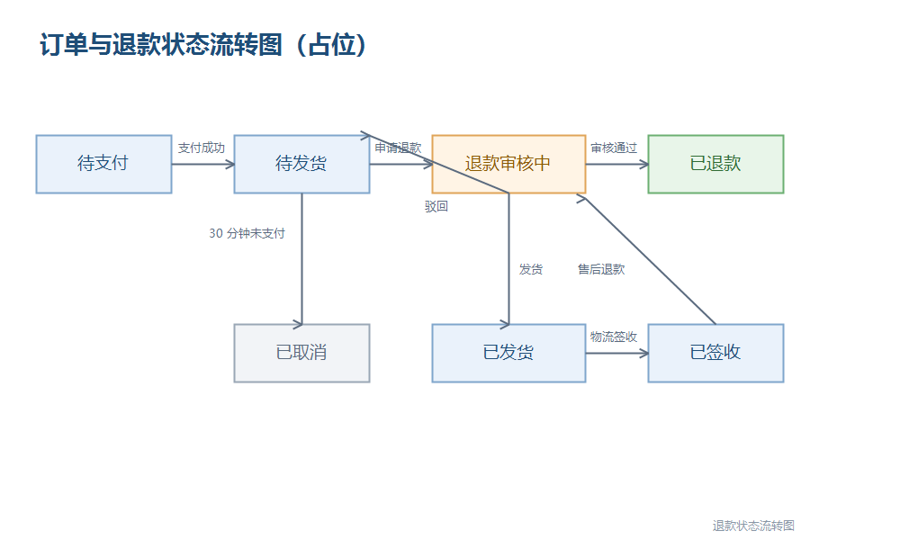
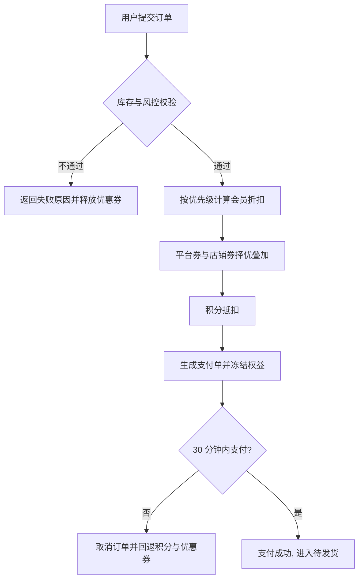
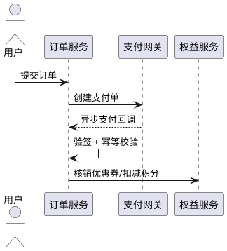
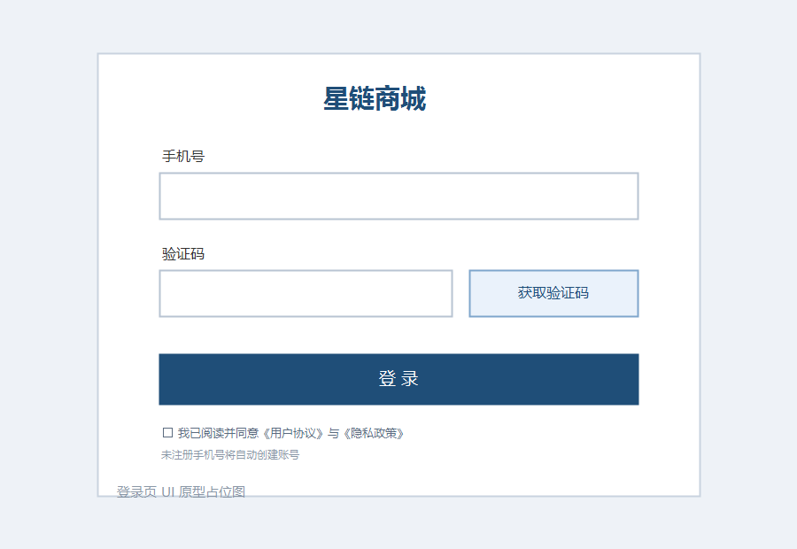
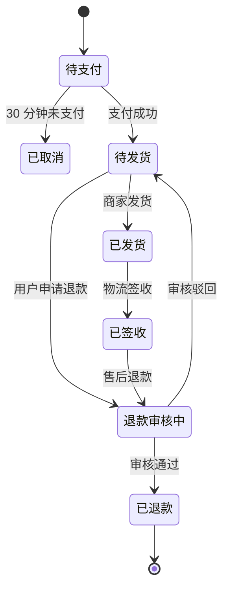

# 星链会员商城 · 订单优惠与退款结算 PRD

> 版本：v1.3  
> 作者：交易产品组  
> 更新时间：2026-11-20  
> 适用范围：App 5.8+、H5、小程序

## 1. 背景与目标

星链会员商城需要统一会员折扣、平台券、店铺券、积分抵扣与售后退款的结算规则。当前各渠道优惠计算逻辑不一致，导致资损与客诉。

本期目标：

- 统一订单优惠计算顺序，保证同一订单在 App、H5、小程序计算结果一致；
- 支持平台券与店铺券叠加，并按“对用户最优”自动选券；
- 支持部分退款按比例分摊优惠，保证退款金额不超过实付金额；
- 建立可审计的退款状态机与幂等机制。

## 2. 角色与权限

| 角色 | 权限 | 关键限制 |
| --- | --- | --- |
| 普通会员 | 下单、申请退款、查看进度 | 单日退款申请不超过 5 次 |
| 黄金/铂金/钻石会员 | 等级折扣、会员专属券 | 等级折扣不可与秒杀价叠加 |
| 商家运营 | 配置店铺券、审核退款 | 单笔退款金额不得超过订单实付金额 |
| 财务 | 对账、导出流水 | 仅可查看脱敏后的支付信息 |
| 风控专员 | 冻结/解冻账户 | 冻结操作需二次审批并记录审计日志 |

## 3. 核心业务流程

### 3.1 下单结算流程

### 3.2 支付回调时序

## 4. 登录与账号校验

### 4.1 字段校验

| 字段 | 必填 | 校验规则 | 异常提示 |
| --- | --- | --- | --- |
| 手机号 | 是 | 11 位数字，符合 `^1[3-9]\d{9}$` | 请输入正确的手机号 |
| 验证码 | 是 | 6 位数字，5 分钟内有效，最多错误 5 次 | 验证码错误或已失效 |
| 邀请码 | 否 | 8 位大写字母或数字 | 邀请码格式不正确 |
| 收货地址 | 是 | 省市区必填，详细地址 5-100 字 | 请完善收货地址 |
| 退款金额 | 是 | 最多 2 位小数，且不超过订单实付金额 | 退款金额不能超过实付金额 |

### 4.2 账号与权限规则

- 同一手机号 24 小时内最多获取 10 次验证码，超过后必须触发图形验证码。
- 账号被风控冻结时，禁止下单、退款和修改收货地址，但允许查看历史订单。
- 未实名认证用户单笔订单金额不得超过 5000 元，超过时必须先完成实名认证。
- 连续 3 次输入错误验证码后，账号锁定 30 分钟并发送短信提醒。

## 5. 优惠计算规则

### 5.1 会员等级折扣

| 等级 | 折扣 | 升级条件 | 单笔折扣上限 |
| --- | --- | --- | --- |
| 普通会员 | 无 | 注册即得 | - |
| 黄金会员 | 95 折 | 累计消费满 1000 元 | 50 元 |
| 铂金会员 | 92 折 | 累计消费满 5000 元 | 150 元 |
| 钻石会员 | 88 折 | 累计消费满 20000 元 | 500 元 |

- 会员折扣仅作用于商品金额，不作用于运费、税费和礼品卡。
- 会员折扣按商品行折后金额逐行计算，四舍五入保留 2 位小数，尾差计入最后一行。
- 黄金及以上会员在生日月额外享受 98 折，生日折扣与等级折扣取较低折扣，不叠加。
- 折扣后商品金额不足 0.01 元时，按 0.01 元结算。

### 5.2 优惠券叠加规则

- 平台券与店铺券可以叠加，同一券种在同一订单中最多使用 1 张。
- 折扣券与满减券不可叠加；系统按“对用户最优”原则自动选择组合。
- 若两种组合优惠金额相同，优先使用距离过期时间更近的优惠券。
- 优惠券门槛按商品折后金额计算，不含运费、税费和礼品卡。
- 优惠券抵扣金额不得超过商品折后金额的 50%，超出部分不抵扣且不返还。
- 秒杀商品、预售定金、虚拟商品不参与平台券和店铺券抵扣。
- 优惠券在提交订单时冻结，订单取消或支付超时后 5 分钟内自动解冻。
- 订单整单退款时优惠券退回账户并恢复原有效期；部分退款时优惠券不退回。

### 5.3 积分抵扣规则

- 积分抵扣比例为 100 积分 = 1 元，单笔订单最多抵扣实付金额的 30%。
- 积分抵扣在会员折扣和优惠券之后计算，抵扣后实付金额不得低于 0.01 元。
- 单笔订单积分抵扣上限为 50000 积分，超出部分不可继续抵扣。
- 积分在提交订单时冻结，支付成功后扣减，取消或超时后原路退回。
- 退款时按退款金额占实付金额的比例退回积分，退还积分保持原有效期；已过期积分不退回。

### 5.4 优惠计算优先级

1. 先计算商品行会员折扣；
2. 再计算平台券与店铺券的最优组合；
3. 然后计算积分抵扣；
4. 最后叠加运费、税费和礼品卡支付；
5. 任何一步计算后实付金额都不得低于 0.01 元。

## 6. 退款与结算规则

### 6.1 状态流转

### 6.2 退款规则

- 未支付订单取消后 5 分钟内释放库存、优惠券和冻结积分。
- 已支付未发货订单支持全额退款，退款金额等于订单实付金额。
- 已支付未发货退款审核时限为 24 小时，超时系统自动通过。
- 已发货订单仅支持售后退款，用户需上传凭证，商家须在 48 小时内响应，超时进入平台仲裁。
- 部分退款按商品行实付金额比例计算，运费仅在整单退款时全额退回。
- 优惠分摊采用“按商品行实付金额比例分摊，尾差计入最后一行”的规则。
- 退款金额不得超过订单实付金额；同一退款单号重复提交必须幂等，返回首次处理结果。
- 退款成功后 1-3 个工作日原路退回；积分与优惠券按第 5 章规则回退。
- 礼品卡支付部分优先退回礼品卡余额，余额不足部分退回原支付渠道。
- 已过期优惠券在整单退款时不恢复，在部分退款时按分摊金额折算补偿。

### 6.3 退款金额计算示例

订单商品金额 1000 元，会员折扣 9 折，平台券减 50 元，积分抵扣 10 元，运费 12 元：

- 商品折后金额：1000 × 0.9 = 900 元；
- 用券后金额：900 - 50 = 850 元；
- 积分抵扣后金额：850 - 10 = 840 元；
- 订单实付金额：840 + 12 = 852 元；
- 若用户仅退其中一件商品（该商品折后实付 420 元），退款金额按 420 元计算，运费不退。

## 7. 风控与异常处理

- 同一用户 24 小时内退款申请超过 5 次，系统必须触发人工审核。
- 同一设备 10 分钟内创建超过 3 个未支付订单，禁止继续下单 30 分钟。
- 风控命中黑名单时，禁止使用优惠券和积分，但允许原价下单。
- 库存扣减必须使用乐观锁，版本号冲突时最多重试 3 次，仍失败则提示“库存紧张，请重试”。
- 支付回调必须验签并校验金额，重复回调不得重复发货或重复退款。
- 优惠计算服务超时超过 2 秒时，降级为不使用优惠券并明确提示用户，禁止按 0 元下单。
- 结算接口必须幂等，相同请求号重复提交返回首次计算结果。
- 退款审核通过后调用支付网关失败时，状态保持“退款审核中”，每 10 分钟重试，最多重试 6 次。

## 8. 非功能需求

- 结算接口 P99 响应时间不超过 800ms，峰值 QPS 5000。
- 优惠计算服务可用性不低于 99.95%，失败时必须可降级。
- 所有退款、冻结、解冻操作保留审计日志不少于 3 年。
- 手机号、银行卡号、身份证号在日志中必须脱敏。
- 订单金额相关字段在数据库中使用 DECIMAL(12,2)，禁止使用浮点数。

## 9. 验收标准

- 所有业务规则均有对应测试用例，BR 覆盖率达到 100%。
- 关键资金路径（下单、支付、退款）必须覆盖正向、边界、异常与幂等场景。
- 同一订单在 App、H5、小程序三端的优惠计算结果完全一致。
- 部分退款后订单实付、已退金额、剩余可退金额三者关系始终正确。
- 风控拦截、服务降级、支付回调重复等异常场景均有明确提示且不产生资损。

## 10. 待确认问题

- 生日月 98 折是否可与平台券叠加，产品尚未明确。
- 部分退款时已过期优惠券的补偿比例，需财务确认。
- 跨境订单税费是否参与优惠分摊，需与税务团队确认。
- 礼品卡退款是否受 1-3 个工作日时效限制，需支付团队确认。
